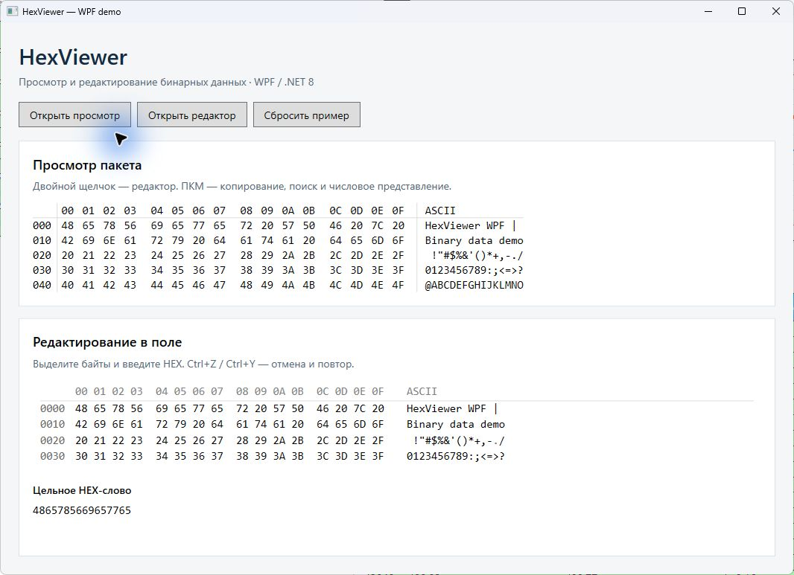
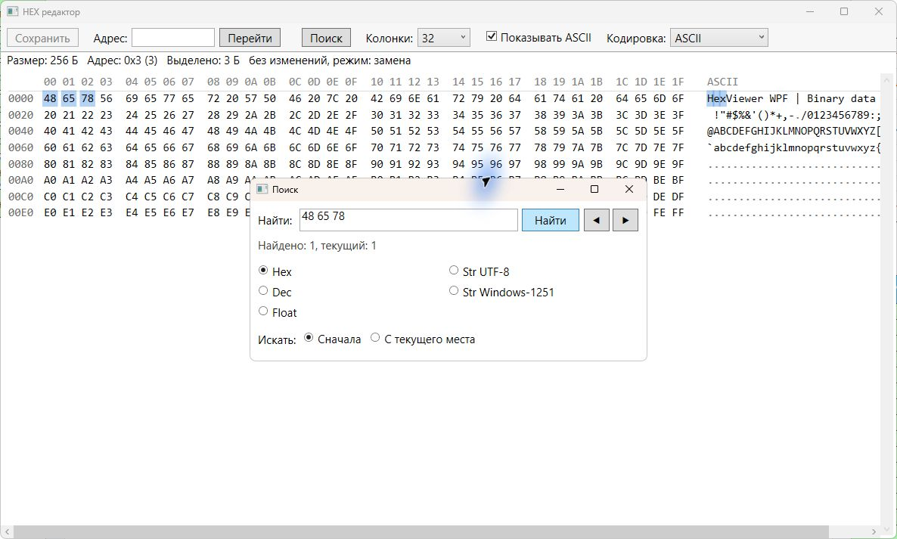

# HexViewer

Независимые WPF-контролы для просмотра и редактирования бинарных данных. Windows, .NET 8, без сторонних UI-библиотек.

## Пример работы



На снимке — запущенный проект `HexViewerDemo` со стандартными WPF-контролами.
Данные синтетические. Пример позволяет открыть отдельные окна просмотра и
редактирования, вызвать поиск и попробовать изменение байтов.

Поиск HEX-последовательности в отдельном редакторе:



## Сборка и запуск

Нужны Windows и .NET 8 SDK либо Visual Studio с компонентом разработки WPF.

```powershell
git clone https://github.com/MORTEM3845/HexViewer.git
cd HexViewer
dotnet build HexViewer.sln -c Release
dotnet run --project HexViewerDemo -c Release
```

Для использования в приложении добавьте ссылку на `HexViewer/HexViewer.csproj`.
Целевая платформа приложения — `net8.0-windows`, свойство `UseWPF` — `true`.
Библиотека не требует сторонних пакетов или дополнительных DLL.

## Оформление

Кнопки, поля ввода, списки и диалоги используют стандартный WPF. Свои неявные
стили можно подключить в ресурсах приложения или окна; отдельная тема не нужна.
Ниже пример ресурсов приложения (пространство имён `viewer` объявите как в
разделе WPF):

```xml
<Application.Resources>
    <Style TargetType="Button">
        <Setter Property="Padding" Value="12,6" />
    </Style>
    <Style TargetType="viewer:HexViewer">
        <Setter Property="Background" Value="#17212B" />
        <Setter Property="Foreground" Value="#E6EDF3" />
        <Setter Property="FontSize" Value="15" />
    </Style>
</Application.Resources>
```

`HexViewer` рисует HEX-содержимое самостоятельно: его цвета и размеры задаются
свойствами контрола. Стандартные диалоги `MessageBox` используют оформление Windows.
При обновлении со старой версии исходники библиотеки находятся в каталоге
`HexViewer/`. Подключите новый `.csproj` вместо прежнего корневого проекта.
Пространство имён основного контрола — `HexViewer.Control.HexViewer`.
Для `WordSizeEnum` замените прежний `using HexViewer.Enums` на
`using HexViewer.Items.Enums`.

## Быстрое редактирование числа

ПКМ → «Редактировать число…» открывает компактную панель рядом с HEX-полем.
Активное выделение имеет приоритет над позицией курсора. Без выделения
редактируется визуальная группа под курсором, включая неполную группу в конце
строки или пакета. Поддерживаются диапазоны от 1 до 8 байтов.

HEX, DEC, DEC ± и BIN доступны одновременно; для 4 байтов дополнительно
доступен Float (IEEE 754), для 8 — Double. Каждый корректный ввод сразу заменяет
байты и обновляет остальные представления; незавершённый ввод остаётся в поле.
Float принимает точку и запятую, NaN и бесконечность. HEX и BIN позволяют задать
любую битовую комбинацию. Длина пакета и соседние байты сохраняются.
Esc или щелчок снаружи закрывает панель; уже внесённые изменения остаются.
Ctrl+Z в панели отменяет последнюю замену. В HexEditor сохраняется обычная история
отмены/повтора. Защищённые байты и запрет редактирования учитываются.

Порядок интерпретации задаётся через ПКМ → «Порядок байтов числа».
WPF `HexEditor.ByteOrder` (`HexByteOrder`, по умолчанию `LittleEndian`)
относится только к числовому редактору и не переставляет байты при отображении:

```csharp
PacketEditor.ByteOrder = HexByteOrder.BigEndian;
```


## WPF

Добавьте пространства имён в XAML:

```xml
xmlns:viewer="clr-namespace:HexViewer.Control.HexViewer;assembly=HexViewer"
xmlns:editor="clr-namespace:HexViewer.Control.HexEditor;assembly=HexViewer"
```

Поле с открытием отдельного редактора по двойному щелчку, Enter или Ctrl+E:

```xml
<viewer:HexViewer x:Name="PacketViewer" Data="{Binding RawData}"
                  IsEditable="True" Columns="16" VisibleRows="4" ShowAscii="True" />
```

`Data` принимает `IList<byte>`. Передавайте результат редактирования в свою модель:

```csharp
PacketViewer.DataChangedExternally += (_, bytes) => viewModel.RawData = bytes;
```

`RawData` должно уведомлять об изменениях через `INotifyPropertyChanged`.
Для внешнего обновления заменяйте список новой коллекцией в UI-потоке.
Присваивание `Data` владельцем не вызывает `DataChangedExternally`.
`IsEditable="False"` запрещает изменение данных.

### Цвета WPF HexViewer

`Background` по умолчанию равен `null`: прозрачная область показывает фон
родительской строки таблицы или списка, включая выделение и изменение фона
во время работы. `Foreground` наследуется от родителя и обновляет весь текст
просмотра: байты, адреса, заголовки и ASCII. Свойства поддерживают стили,
привязки и динамические ресурсы WPF.

```xml
<!-- Цвета строки видны автоматически; отдельная привязка фона не нужна. -->
<viewer:HexViewer Data="{Binding RawData}" IsCompact="True"
                  Columns="4" VisibleRows="1" ShowMoreButtonEnabled="False" />

<!-- Явные цвета перекрывают фон и цвет текста родителя. -->
<viewer:HexViewer Data="{Binding RawData}"
                  Background="#203040" Foreground="White" />
```

Чтобы снова показывать фон строки, задайте `Background="{x:Null}"` или
`Background="Transparent"`. `ClearValue(HexViewer.ForegroundProperty)`
удаляет локальное значение цвета текста и возвращает действие стилей
и наследования. Эти свойства относятся к WPF `HexViewer`.

В `DataGridTemplateColumn` компактный просмотр наследует `Foreground` ячейки,
в том числе при выделении и снятии выделения строки. Не задавайте локальный
`Foreground`, если цветом текста должен управлять стиль таблицы:

```xml
<DataGrid ItemsSource="{Binding Packets}" AutoGenerateColumns="False">
    <DataGrid.Columns>
        <DataGridTemplateColumn Header="Данные">
            <DataGridTemplateColumn.CellTemplate>
                <DataTemplate>
                    <viewer:HexViewer Data="{Binding RawData}" IsCompact="True"
                                      Columns="16" VisibleRows="1"
                                      ShowMoreButtonEnabled="False" />
                </DataTemplate>
            </DataGridTemplateColumn.CellTemplate>
        </DataGridTemplateColumn>
    </DataGrid.Columns>
</DataGrid>
```

Для редактирования непосредственно в поле используйте `HexEditor`:

```xml
<editor:HexEditor x:Name="PacketEditor" Data="{Binding RawData}"
                  Columns="4" VisibleRows="1" ShowHeader="False" ShowOffsets="False"
                  ShowAscii="False" IsInline="True" />
```

Редактор работает со своим буфером:

```csharp
viewModel.RawData = PacketEditor.GetBytes(); // Получить результат.
PacketEditor.SetBytes(bytes); // Загрузить новый пакет.
PacketEditor.SetReadOnlyBytes(new[] { 0, 5 }); // Защитить первый и шестой байты.
PacketEditor.SetReadOnlyBytes(Array.Empty<int>()); // Снять защиту.
```

`IsByteReadOnly(index)` проверяет защиту. Пользовательская операция, затрагивающая
защищённые байты или сдвигающая их позиции, отклоняется целиком.
Программный `SetBytes` обновляет данные независимо от защиты.

## Цельное HEX-слово

```xml
<editor:HexEditor Data="{Binding RawData}" DisplayMode="Word"
                  Columns="4" VisibleRows="1" IsInline="True" />
<viewer:HexViewer Data="{Binding RawData}" DisplayMode="Word"
                  Columns="4" VisibleRows="1" ShowMoreButtonEnabled="False" />
```

Байты `12 AB 00 FF` отображаются как `12AB00FF`: без адресов, ASCII, промежутков
и побайтовых цветов. Выделение, каретка, ввод, отмена и защита сохраняются.
`DisplayMode="Bytes"` возвращает обычный вид. Данные не меняются.

## Настраиваемые свойства

Свойства WPF `HexViewer`.

| Свойство | Тип | По умолчанию | Назначение |
|---|---|---:|---|
| `DisplayMode` | `HexDisplayMode` | `Bytes` | `Bytes` — обычные байты; `Word` — слитное HEX-слово без побайтовых украшений и tooltip. То же свойство есть в окнах `HexViewerWindow`/`HexEditorWindow`. |
| `Data` | `IList<byte>` | `null` | Отображаемые байты. |
| `Background` | `Brush?` | `null` | Фон WPF `HexViewer`. `null` и `Transparent` показывают фон родителя; явная кисть заливает всю область, в том числе без данных. |
| `Foreground` | `Brush` | `Black` | Наследуемый цвет всего текста WPF `HexViewer`; значение родителя или стиля заменяет чёрный цвет по умолчанию. |
| `Columns` | `int` | `32` | Количество байтов в строке. |
| `AutoFitColumnsToWidth` | `bool` | `false` | Режим Auto по ширине, общий с `HexEditor`; учитывает смещения, группы и ASCII. |
| `CellWidth` | `double` | `28` | Ширина ячейки при `FontSize=15`; фактическая ширина масштабируется на `FontSize / 15`. |
| `CellHeight` | `double` | `20` | Высота строки. |
| `GroupSize` | `int` | `4` | Количество байтов в группе. |
| `GroupSpacing` | `double` | `8` | Интервал между группами при `FontSize=15`; масштабируется на `FontSize / 15`. |
| `VisibleRows` | `int` | `8` | Количество видимых строк без автоподбора. |
| `AutoFitRowsToHeight` | `bool` | `false` | Подбирать количество строк по доступной высоте; ограничивать прокрутку по фактически видимым строкам. |
| `ShowMoreButtonEnabled` | `bool` | `true` | Показывать кнопку открытия полного содержимого; при `false` не резервировать её высоту. |
| `ShowAscii` | `bool` | `false` | Показывать текстовую колонку справа. |
| `TextEncoding` | `HexTextEncoding` | `Ascii` | Кодировка текстовой колонки: `Ascii`, `Utf8` или `Windows1251`. |
| `IsCompact` | `bool` | `false` | Скрывать заголовок и колонку смещений. |
| `FontSize` | `double` | `15` | Размер HEX-текста; вместе с ним меняются ширина ячеек и промежутки между группами. |
| `FirstVisibleRowIndex` | `int` | `0` | Индекс первой видимой строки. |
| `IsEditable` | `bool` | `true` | Разрешать изменение данных. |
| `VisualByteOffset` | `int` | `0` | Визуальное смещение данных: `0`–`3`. |
| `HighlightedRangeStart` | `int` | `-1` | Начало подсвеченного диапазона; `-1` отключает подсветку. |
| `HighlightedRangeLength` | `int` | `0` | Длина подсвеченного диапазона. |
| `WordDisplaySize` | `WordSizeEnum` | `Byte4` | Размер слова: `Byte1`, `Byte2` или `Byte4`; задаёт группировку. |
| `ByteOrder` | `HexByteOrder` | `LittleEndian` | Интерпретация числа в tooltip и `HoveredValue`: `LittleEndian` (младший байт первый) или `BigEndian` (старший байт первый). |
| `ByteDisplayOrder` | `HexByteDisplayOrder` | `AddressOrder` | `AddressOrder` показывает байты по адресам, `ReverseWithinWord` разворачивает байты внутри видимой группы слова. Не меняет данные или интерпретацию числа. |
| `IsLoadFromBinVisible` | `bool` | `true` | Показывать команду загрузки BIN при доступном редактировании. |

Для автоподбора родитель должен ограничивать соответствующее измерение.
`AutoFitColumnsToWidth` подбирает число колонок с шагом 4, минимум 4;
при неограниченной ширине использует `Columns`, округлённое вниз до кратного четырём.
При неограниченной высоте используется `VisibleRows`.

`ByteOrder` задаёт интерпретацию числа, `ByteDisplayOrder` — только порядок
отображения. Например, `14 00 00 00` при `LittleEndian` означает 20;
`ReverseWithinWord` показывает `00 00 00 14`, не меняя пакет.

При смене `WordDisplaySize` устанавливаются `GroupSize` и `GroupSpacing`:
`Byte1` — 1 и 1, `Byte2` — 2 и 4, `Byte4` — 4 и 8.
Собственную группировку задавайте после выбора размера слова.
В WPF `HexViewer` сочетания Ctrl+1, Ctrl+2 и Ctrl+4 выбирают соответственно
1, 2 и 4 байта, сохраняя привязку `WordDisplaySize` и сами данные.
Они работают при фокусе на контроле, а в отдельном `HexViewerWindow` — также
при фокусе на панели управления. Переключение доступно при `IsEditable="False"`.
Начальный размер можно задать в XAML: `<viewer:HexViewer WordDisplaySize="Byte2" />`.
Все перечисленные свойства WPF `HexViewer` — dependency properties,
кроме `FirstVisibleRowIndex`, обычного CLR-свойства для программной прокрутки.

Дополнительные параметры встроенного WPF-редактора:

| Свойство `HexEditor` | Тип | По умолчанию | Назначение |
|---|---|---:|---|
| `DisplayMode` | `HexDisplayMode` | `Bytes` | `Word` — слитный текст, непрерывное выделение, без заголовка, смещений, ASCII, побайтовых цветов и tooltip. |
| `AutoFitColumnsToWidth` | `bool` | `false` | Режим Auto по ширине, с шагом 4 колонки; `Columns` используется при неограниченной ширине. |
| `ShowHeader` | `bool` | `true` | Показывать строку индексов колонок и разделительную линию. При `false` не резервировать её высоту. |
| `ShowOffsets` | `bool` | `true` | Показывать адреса строк. При `false` не резервировать их ширину. |
| `IsInline` | `bool` | `false` | Прозрачный фон без заливки текущего и защищённых байтов. Каретка и выделение пользователем сохраняются. |
